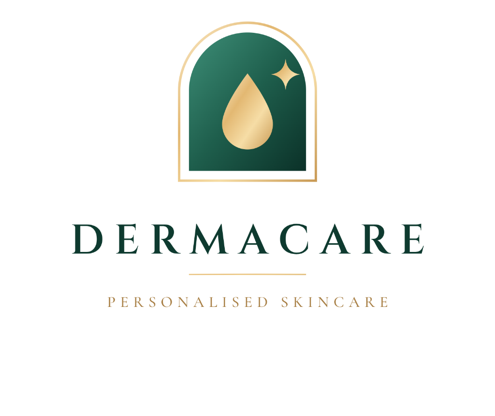

# DermaCare — Personalised Skincare & Dermatology

<div align="center">
  
  <br/>
  <p><strong>A luxury, personalized skincare companion and dermatology consultation mobile application tailored for users in Nepal.</strong></p>
  <p>
    Built with <strong>Flutter 3.27+</strong> • <strong>Material 3</strong> • <strong>Riverpod 3.x</strong> • <strong>GoRouter</strong> • <strong>Android Native Adaptive Icons</strong>
  </p>
</div>

---

## 📋 Table of Contents
1. [Executive Summary](#-executive-summary)
2. [Nepal Market Localization](#-nepal-market-localization)
3. [Architecture & Technology Stack](#-architecture--technology-stack)
4. [Complete Feature Breakdown](#-complete-feature-breakdown)
   - [Startup & Splash Experience](#1-startup--splash-experience)
   - [Authentication & User Management](#2-authentication--user-management)
   - [Personalized Onboarding (6 Steps)](#3-personalized-onboarding-6-steps)
   - [Home Dashboard & Skincare Habit Tracking](#4-home-dashboard--skincare-habit-tracking)
   - [Membership Plans & Payment Integration](#5-membership-plans--payment-integration)
   - [Doctor Consultations & Appointments](#6-doctor-consultations--appointments)
   - [Digital Prescriptions & Progress Tracking](#7-digital-prescriptions--progress-tracking)
   - [Dermi: Real AI Voice Skincare Assistant](#8-dermi-real-ai-voice-skincare-assistant)
   - [Profile, Settings & Sound Effects](#9-profile-settings--sound-effects)
5. [Theming & Design System (Luxury Emerald & Ivory)](#-theming--design-system)
   - [Color Tokens & Palette](#color-tokens--palette)
   - [WCAG 2.1 Contrast Ratios](#wcag-21-contrast-ratios)
   - [Material 3 Custom ColorScheme & ThemeExtension](#material-3-custom-colorscheme--themeextension)
   - [Typography Hierarchy](#typography-hierarchy)
6. [Android Platform Optimization](#-android-platform-optimization)
   - [Adaptive Icons & Densities](#adaptive-icons--densities)
   - [Native Splash Screen (Cold Start & Android 12+)](#native-splash-screen-cold-start--android-12)
7. [Sound & Haptics Engine](#-sound--haptics-engine)
8. [Backend API Specification (Django REST Framework)](#-backend-api-specification)
9. [Project Directory Structure](#-project-directory-structure)
10. [Setup & Running Instructions](#-setup--running-instructions)

---

## 🌟 Executive Summary

**DermaCare** bridges the gap between daily personalized skincare routines and certified medical dermatology consultations in Nepal. The application is crafted with a "luxury skincare clinic" aesthetic: deep emerald green, warm ivory, and champagne gold accents—deliberately avoiding sterile clinical whites or playful cartoon visuals.

The frontend is 100% complete with 25+ production-ready screens, interactive physics-based animations, persistent state management, real local notifications, an AI voice companion, and seamless Android OS integration.

---

## 🇳🇵 Nepal Market Localization

Every workflow in DermaCare is engineered specifically for the Nepali healthcare and consumer landscape:

* **Currency**: Nepali Rupee (NPR), rendered cleanly as `Rs.` (internally tracked in integer paisa to guarantee arithmetic precision).
* **Phone Validation**: Validates Nepali mobile numbers matching the `98XXXXXXXX` and `97XXXXXXXX` telecom formats (NTC / Ncell / Smart Cell).
* **Timezone Handling**: Accurate schedule alignment to **Nepal Time (NPT, UTC+5:45)** with automatic midnight resets for water and habit trackers.
* **Payment Gateways**: Dedicated mock checkout interfaces for Nepal’s major digital wallets: **eSewa**, **Khalti**, **ConnectIPS**, and Mobile Banking.
* **Local Test Accounts & Personas**: Pre-seeded with authentic Kathmandu personas:
  * **Sujana Shrestha** (`9801234567` / `password123`) — 19, Student, Oily/Acne skin
  * **Triyog Shrestha** (`9812345678` / `password123`) — 28, Professional, Dry/Pigmentation skin
  * **Rasmi Thapa** (`9823456789` / `password123`) — 40, Teacher/Parent, Sensitive skin

---

## 🏗️ Architecture & Technology Stack

```
lib/
├── core/                         # Cross-cutting foundational modules
│   ├── errors/                   # App exceptions & Failure domain models
│   ├── network/                  # Dio HTTP client configuration (API ready)
│   ├── notifications/            # Local notifications scheduling
│   ├── routing/                  # Centralized GoRouter & route transitions
│   ├── services/                 # AI voice assistant, Sound, Haptics
│   ├── storage/                  # SecureStorage & SharedPreferences services
│   ├── theme/                    # Material 3 ColorScheme, ThemeExtension, Spacing
│   ├── utils/                    # Result monad, Validators, App constants
│   └── widgets/                  # Atomic UI library (Buttons, Cards, States, Inputs)
│
├── features/                     # Feature-first domain modules
│   ├── splash/                   # Luxury animated brand splash
│   ├── auth/                     # Login, Registration, Token management
│   ├── onboarding/               # 6-step clinical skin profiling flow
│   ├── home/                     # Dynamic dashboard with hydration & routines
│   ├── membership/               # Tiered plans & local payment flows
│   ├── doctors/                  # Doctor directory & appointment booking
│   ├── prescriptions/            # Digital prescriptions & instructions
│   ├── progress/                 # Photo gallery comparison & daily skin journal
│   ├── profile/                  # Account management, Settings, About
│   └── assistant/                # Interactive Voice Chat with Dermi
│
└── main.dart                     # Application root & Riverpod ProviderScope
```

* **Framework**: Flutter 3.27+ with Dart 3.6+
* **State Management**: **Riverpod 3.x** using code-generated notifiers (`@riverpod`) and persistent `keepAlive: true` singletons.
* **Routing**: **GoRouter 14.x** with declarative nested routes, path parameters, and transition builders.
* **Storage**: `flutter_secure_storage` for JWT tokens and `shared_preferences` for theme and user settings.
* **Animations**: `flutter_animate`, `shimmer`, custom `AnimationController` tickers, and canvas-drawn water physics.

---

## 📱 Complete Feature Breakdown

### 1. Startup & Splash Experience
* **Official Luxury Branding**: Centered high-resolution DermaCare emblem featuring the emerald arch, golden serum drop, and sparkle.
* **Controlled Navigation**: Strictly waits for the user to touch anywhere on the screen—no sudden automatic timer redirects.
* **Interactive Prompt**: Features an animated breathing badge (`Tap anywhere to continue →`) with full-screen hit-testing.
* **Instant Native Launching**: Zero white flashes during cold boot via native Android splash drawables.

### 2. Authentication & User Management
* **Login Screen**:
  * Phone field auto-formatted for Nepal numbers with validation.
  * Password input with show/hide toggle.
  * Direct one-tap "Test Accounts" panel for instant evaluation.
  * Secure token storage (`accessToken`, `refreshToken`, `userId`).
* **Registration Screen**:
  * Full Name, Phone, optional Email, and Password with validation.
  * Terms & Conditions acceptance.
  * Auto-transition directly into the onboarding skin diagnostic.

### 3. Personalized Onboarding (6 Steps)
A clinical-grade onboarding assessment to personalize treatments:
1. **Welcome Screen**: Introduction with branding and privacy consent.
2. **Skin Profile Screen**:
   * Skin Type: *Dry, Oily, Combination, Normal, Sensitive*.
   * Skin Concerns: *Acne, Dark Spots, Wrinkles, Dryness, Oiliness, Redness, Large Pores, Sensitivity*.
   * Skin Goals: *Clear Skin, Even Tone, Anti-Aging, Hydration, Oil Control, Sensitivity Reduction*.
3. **Lifestyle Assessment**: Sleep duration, stress levels, sun exposure, and water consumption habits.
4. **Hydration Profile**: Computes optimal daily water intake target in milliliters.
5. **Medical History**: Known drug allergies, current medications, and past dermatological conditions.
6. **Onboarding Complete**: Displays personalized treatment summary and navigates to the home dashboard.

### 4. Home Dashboard & Skincare Habit Tracking
* **Personalized Greeting**: Dynamic welcome card reflecting user's profile and time of day.
* **Interactive Hydration Card**:
  * Live visual water glass animation that fills with liquid as water is logged.
  * Log glasses with a single tap, triggering water-drop sound effects and haptic feedback.
  * Daily goal progress bar (e.g., 6/8 glasses) with achievement celebrations.
* **Daily Skincare Routine Checklist**:
  * Split into Morning (`AM`) and Evening (`PM`) steps (Cleanser, Toner, Serum, Moisturizer, SPF).
  * Interactive completion checkboxes that track daily streak count.
* **Care Plan Card**: Quick glance at active doctor consultations and check-in timelines.

### 5. Membership Plans & Payment Integration
* **Tiered Subscription Plans**:
  * **Basic Care** (`Rs. 399/mo`): 1 consultation, weekly check-ins, routine planner.
  * **Glow Pro** (`Rs. 799/mo`): 3 consultations, priority doctor chat, free product samples.
  * **Dermatology Plus** (`Rs. 1,499/mo`): Unlimited follow-ups, dedicated dermatologist, custom routine formulations.
* **Localized Checkout Screen**:
  * Integration selection: **eSewa** (Green), **Khalti** (Purple), **ConnectIPS**, **Mobile Banking**.
  * Payment summary with breakdown in NPR.
  * Processing simulation with animated loading indicator.
* **Payment Success Screen**: Transaction ID generation, digital receipt, and tier activation.

### 6. Doctor Consultations & Appointments
* **Doctor Directory**:
  * Certified Nepali dermatologists with NMC registration numbers.
  * Filters for Specialization (Acne, Anti-Aging, Pigmentation, Pediatric).
  * Affiliated clinics (Kathmandu Dermatology, Patan Hospital, Bir Hospital).
* **Doctor Profile View**: Qualifications (MBBS, MD Dermatology), years of experience, patient reviews, and consultation fee.
* **Appointment Booking Engine**:
  * Interactive date calendar and dynamic time slot grid.
  * Consultation mode: Video Call vs. In-Person Clinic Visit.
  * Problem description and optional photo attachment.
* **Appointment Confirmation**: Booking ticket with calendar integration and reminder alert scheduling.

### 7. Digital Prescriptions & Progress Tracking
* **Digital Prescriptions**:
  * List of active, completed, and past dermatological prescriptions.
  * Detailed medication cards: Medicine name, dosage, timing (Morning/Night), frequency, and duration.
  * Doctor notes, application guidelines, and warnings.
* **Skin Progress Photo Gallery**:
  * Front, left-profile, and right-profile angle submissions.
  * Side-by-side Before/After comparison slider.
  * Weekly timeline documenting skin improvements over 4 to 12 weeks.
* **Daily Skin Journal / Skin Logs**:
  * Rate skin feeling (1-5), redness severity, oiliness levels, and acne breakouts.
  * Notes on environmental factors (pollution, weather, dietary triggers).

### 8. Dermi: Real AI Voice Skincare Assistant
* **AI Engine Integration**: Integrated with OpenAI GPT (`gpt-3.5-turbo`) tailored with a specialized clinical skincare system prompt.
* **Voice In & Voice Out**:
  * **Speech-to-Text (`speech_to_text`)**: Real-time voice transcription allowing hands-free questions.
  * **Text-to-Speech (`flutter_tts`)**: Natural spoken responses from Dermi.
* **Animated Character Reactions**: Dermi character mouth and eye animations synchronize with speaking and listening states.
* **Conversation Memory**: Contextual recollection of the last 10 conversational turns with an app-bar clear button.
* **Graceful Offline Fallback**: Built-in pattern-matching engine responds intelligently even without internet connectivity.

### 9. Profile, Settings & Sound Effects
* **Profile Management**: Edit name, phone, email, and view diagnostic skin metrics.
* **Settings**: Toggle Push Notifications, Sound Effects, Haptic Vibrations, and Privacy Consent.
* **Help Center & FAQ**: Answers to recurring skincare questions and medical emergency hotlines in Nepal.
* **About DermaCare**: App version, licensing, terms of service, and clinical advisory board credentials.

---

## 🎨 Theming & Design System

The app utilizes an explicit **Material 3 Theming Architecture** designed without `ColorScheme.fromSeed` to ensure colors remain true to brand standards.

### Color Tokens & Palette

| Token Role | Light Mode | Dark Mode | Usage |
| :--- | :--- | :--- | :--- |
| **Background** | `#FBF7EE` (Warm Ivory) | `#0A1A15` (Deep Obsidian) | Scaffold canvas |
| **Surface / Card** | `#FFFDF8` (Soft Cream) | `#10231D` (Emerald-Charcoal) | Cards, sheets, dialogs |
| **Surface High** | `#F3EDDF` | `#173028` | Elevated containers, chips |
| **Primary** | `#0E3A2F` (Deep Forest) | `#6FC2A5` (Luminous Sage) | Headers, primary CTA |
| **On Primary** | `#FBF7EE` | `#06241B` | Text on primary buttons |
| **Primary Container** | `#D7EBE2` | `#1E5E4C` | Active badges, selected tabs |
| **On Primary Container** | `#0B2F27` | `#D7EBE2` | Text inside primary container |
| **Secondary** | `#1E5E4C` | `#8FD3BA` | Secondary accents, outlines |
| **Gold (Decorative)** | `#E3B872` | `#E8C27E` | Hairlines, borders, badges |
| **Gold Text (AA)** | `#8A6420` | `#E8C27E` | Small gold text (meets 5:1 contrast) |
| **Success** | `#2E7D5B` | `#7FD1A5` | Completed goals, checkmarks |
| **Warning** | `#B7791F` | `#E8B866` | Caution alerts |
| **Warning Text (AA)** | `#99600F` | `#E8B866` | Warning text labels (meets 4.87:1) |
| **Error** | `#A8322D` | `#F2B8B5` | Form errors, failed payments |

### WCAG 2.1 Contrast Ratios

All tokens pass WCAG Level AA (>= 4.5:1 for body copy, >= 3.0:1 for graphical objects):

* `textPrimary on background` (Light): **14.85:1** (AAA)
* `textPrimary on background` (Dark): **15.48:1** (AAA)
* `goldText on background` (Light): **5.00:1** (AA)
* `warningText on background` (Light): **4.87:1** (AA)
* `onPrimary on primary` (Light): **11.80:1** (AAA)
* `onPrimary on primary` (Dark): **7.79:1** (AAA)

### Material 3 Custom ColorScheme & ThemeExtension

Brand tokens Material does not represent natively are exposed via `DermaCareThemeExtension`:
```dart
// Accessible anywhere in the widget tree:
final dermaTheme = context.dermaTheme;

// 135-degree luxury emerald gradient
Container(decoration: BoxDecoration(gradient: dermaTheme.brandGradient));

// Metallic gold gradient for premium badges
Container(decoration: BoxDecoration(gradient: dermaTheme.goldGradient));

// Gold hairline border
Container(decoration: BoxDecoration(border: Border.fromBorderSide(dermaTheme.goldHairline)));
```

### Typography Hierarchy
* **Display & Headings** (`>= 22sp`): Classic high-contrast luxury serif styling (`Cormorant Garamond` aesthetic).
* **Body, Controls & Labels**: Clean geometric-humanist typography (`Plus Jakarta Sans` aesthetic) with tall x-height and open counters.
* **Nepali Script Fallback**: Configured with `Noto Sans Devanagari` in the font fallback chain.

---

## 🤖 Android Platform Optimization

The app is tuned for the Android OS ecosystem:

### Adaptive Icons & Densities
Standard square, circular round, and adaptive icon layers generated from the master logo:
* `mipmap-mdpi`: 48×48 px (Foreground: 108×108 px)
* `mipmap-hdpi`: 72×72 px (Foreground: 162×162 px)
* `mipmap-xhdpi`: 96×96 px (Foreground: 216×216 px)
* `mipmap-xxhdpi`: 144×144 px (Foreground: 324×324 px)
* `mipmap-xxxhdpi`: 192×192 px (Foreground: 432×432 px)
* **Adaptive XML Manifests**: Configured in `mipmap-anydpi-v26/ic_launcher.xml` and `ic_launcher_round.xml` with safe-zone inset padding on pure white background (`#FFFFFF`).

### Native Splash Screen (Cold Start & Android 12+)
* **Android 11 & Below**: `drawable/launch_background.xml` and `drawable-v21/launch_background.xml` centers the launcher icon against a solid window background.
* **Android 12, 13, 14, 15+**: `values-v31/styles.xml` configures the official Window Splash Screen API:
  ```xml
  <style name="LaunchTheme" parent="@android:style/Theme.Light.NoTitleBar">
      <item name="android:windowSplashScreenBackground">@android:color/white</item>
      <item name="android:windowSplashScreenAnimatedIcon">@mipmap/ic_launcher</item>
  </style>
  ```
* **Application Title**: Manifest configured with `android:label="DermaCare"`.

---

## 🔊 Sound & Haptics Engine

Implemented via `SoundService` (`lib/core/services/sound_service.dart`) using `audioplayers` and `vibration`:

| Action Trigger | Audio Effect | Haptic Pattern | Volume |
| :--- | :--- | :--- | :--- |
| Primary Button Press | `playTap()` | Light impact | 30% |
| Glass of Water Logged | `playWaterDrop()` | Light impact | 50% |
| Action Completed / Saved | `playSuccess()` | Medium impact | 60% |
| Validation Error / Alert | `playError()` | Heavy vibration | 50% |
| Goal Milestone Reached | `playAchievement()` | Triple vibration | 80% |
| Voice Message Sent | `playMessageSent()` | Selection tick | 40% |
| AI Response Arrived | `playMessageReceived()` | None | 40% |

---

## 🌐 Backend API Specification

Ready to bind with a production Django REST Framework backend:

### Authentication Endpoints
* `POST /api/v1/auth/login/` — Authenticate via Nepal phone & password; returns JWT pair.
* `POST /api/v1/auth/register/` — Create new user record.
* `POST /api/v1/auth/token/refresh/` — Rotate access token using refresh token.

### Clinical & Skincare Endpoints
* `GET /api/v1/onboarding/profile/` — Fetch saved skin diagnostic metrics.
* `POST /api/v1/onboarding/submit/` — Save 6-step onboarding assessment.
* `GET /api/v1/doctors/` — Query doctor list with specialty and clinic filters.
* `POST /api/v1/appointments/book/` — Create new consultation booking.
* `GET /api/v1/prescriptions/` — Retrieve user's digital prescriptions.
* `POST /api/v1/progress/photos/upload/` — Secure multipart upload for weekly check-ins.
* `POST /api/v1/assistant/chat/` — Forward user query to LLM proxy.

---

## 📁 Project Directory Structure

```
Finalassignment/
├── android/                      # Android native platform files
│   └── app/src/main/
│       ├── AndroidManifest.xml   # Label "DermaCare" & icon declarations
│       └── res/
│           ├── drawable/         # Launch background XML
│           ├── mipmap-anydpi-v26/# Adaptive icon definitions
│           ├── mipmap-*dpi/      # Rasterized launcher & round icons
│           ├── values/           # Colors & launch styles
│           └── values-v31/       # Android 12+ splash configuration
│
├── assets/
│   ├── brand/                    # High-resolution master brand assets (1024px)
│   ├── images/logo/              # App logo & icon assets
│   ├── animations/               # Lottie animation assets
│   └── sounds/                   # Sound effect MP3 files
│
├── lib/
│   ├── core/
│   │   ├── routing/app_router.dart
│   │   ├── services/
│   │   │   ├── ai_assistant_service.dart
│   │   │   ├── sound_service.dart
│   │   │   └── voice_assistant_service.dart
│   │   └── theme/
│   │       ├── app_colors.dart
│   │       ├── app_theme.dart
│   │       ├── app_theme_extension.dart
│   │       └── color_scheme.dart
│   │
│   ├── features/
│   │   ├── assistant/presentation/screens/voice_chat_screen.dart
│   │   ├── auth/presentation/screens/login_screen.dart
│   │   ├── doctors/presentation/screens/doctors_list_screen.dart
│   │   ├── home/presentation/screens/home_screen.dart
│   │   ├── membership/presentation/screens/membership_plans_screen.dart
│   │   ├── onboarding/presentation/screens/welcome_screen.dart
│   │   ├── prescriptions/presentation/screens/prescriptions_list_screen.dart
│   │   ├── profile/presentation/screens/profile_screen.dart
│   │   ├── progress/presentation/screens/progress_photos_screen.dart
│   │   └── splash/presentation/screens/splash_screen.dart
│   │
│   └── main.dart
│
├── test/
│   └── theme/contrast_test.dart  # Automated WCAG 2.1 AA/AAA verification test
│
├── pubspec.yaml                  # Dependencies and assets manifest
└── README.md                     # Single comprehensive master documentation
```

---

## 🚀 Setup & Running Instructions

### Prerequisites
* Flutter SDK (`>= 3.27.0`)
* Android Studio / Android SDK (API 34+ recommended)
* Physical Android device with USB debugging enabled OR Android Emulator

### Installation & Run

1. **Clone & Install Dependencies**:
   ```bash
   flutter pub get
   ```

2. **Run WCAG Contrast & Unit Tests**:
   ```bash
   flutter test test/theme/contrast_test.dart
   ```

3. **Verify Static Analysis**:
   ```bash
   flutter analyze
   ```

4. **Launch on Android**:
   ```bash
   flutter run -d android
   ```

---

<div align="center">
  <p><strong>DermaCare — Glow naturally, every day. ✨</strong></p>
  <p>© 2026 DermaCare Nepal. All rights reserved.</p>
</div>
